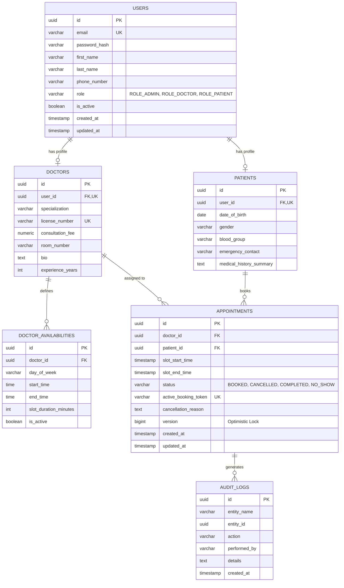

# Hospital Appointment and Queue Management System (HMS)

> A production-ready, highly concurrent Spring Boot 3.3 REST API built to eliminate double bookings, streamline outpatient scheduling, and provide role-based administrative visibility.

---

## 1. Key Business Problem & Solutions

Small clinics and outpatient clinics rely on manual registers and phone calls, causing:
1. **Double Bookings**: Addressed via a **three-tier concurrency defense**:
   - Application-layer fast-fail check.
   - Pessimistic write lock (`@Lock(LockModeType.PESSIMISTIC_WRITE)`) on the doctor scheduling template during the booking transaction.
   - Database unique constraint on `active_booking_token` (`doctor_id + "_" + slot_start_time`) and PostgreSQL partial index (`WHERE status NOT IN ('CANCELLED')`).
   - JPA Optimistic Locking (`@Version`) protecting against dirty writes on appointment rescheduling and cancellations.
2. **Waiting Times & Doctor Availability**:
   - Dynamic `SlotCalculationService` that computes free intervals (e.g., 30-min slots) matching doctors' active weekly schedules, automatically suppressing already-booked or past slots.
3. **Audit Trails & Security**:
   - Stateless **Spring Security 6** with **JJWT 0.12.6** implementing Role-Based Access Control (`PATIENT`, `DOCTOR`, `ADMIN`).
   - Asynchronous audit logging (`AuditService`) on all booking state transitions.
4. **Booking Confirmations**:
   - Decoupled asynchronous event notifications (`@TransactionalEventListener(phase = AFTER_COMMIT)`) triggering email delivery via `JavaMailSender` without blocking the HTTP request thread.

---

## 2. Tech Stack

- **Java**: 17 LTS / JDK 24 compatible
- **Framework**: Spring Boot 3.3.5
- **Frontend**: React 18, Vite, React Router v6, Botanical Glassmorphic Design System (plain CSS with design tokens)
- **Persistence**: Spring Data JPA & Hibernate 6
- **Database**: PostgreSQL 16 (production) / H2 in PostgreSQL compatibility mode (dev/test)
- **Database Migrations**: Flyway Core & Flyway PostgreSQL
- **Security**: Spring Security 6 + JJWT 0.12.6
- **Documentation**: Springdoc OpenAPI 2.6.0 (Swagger UI v3)
- **Containerization**: Docker Compose (PostgreSQL, Mailpit, Redis)
- **Testing**: JUnit 5, Mockito, Spring Boot Test, Multi-threaded Concurrency Execution

---

## 3. Database Schema Design (ERD)



---

## 4. API Endpoints Directory

All protected endpoints require `Authorization: Bearer <token>`.

### Authentication (`/api/v1/auth`)
| Method | Endpoint | Access | Description |
| :--- | :--- | :--- | :--- |
| `POST` | `/api/v1/auth/register` | Public | Register a new user (`ROLE_PATIENT` or `ROLE_DOCTOR`) |
| `POST` | `/api/v1/auth/login` | Public | Authenticate with email/password; returns JWT token |

### Doctors (`/api/v1/doctors`)
| Method | Endpoint | Access | Description |
| :--- | :--- | :--- | :--- |
| `GET` | `/api/v1/doctors` | Public | List all active doctors (optional filter: `?specialization=...`) |
| `GET` | `/api/v1/doctors/{id}` | Public | Get doctor profile and details |
| `GET` | `/api/v1/doctors/{id}/slots` | Public | Get computed free/booked slots for a date (`?date=YYYY-MM-DD`) |
| `POST` | `/api/v1/doctors` | `ADMIN` | Onboard a new doctor |
| `GET` | `/api/v1/doctors/{id}/availabilities` | Authenticated | View doctor weekly schedule templates |
| `POST` | `/api/v1/doctors/{id}/availabilities` | `DOCTOR`, `ADMIN` | Set or update weekly availability window |
| `DELETE` | `/api/v1/doctors/{id}/availabilities/{availId}` | `DOCTOR`, `ADMIN` | Remove an availability schedule |

### Patients (`/api/v1/patients`)
| Method | Endpoint | Access | Description |
| :--- | :--- | :--- | :--- |
| `GET` | `/api/v1/patients/me` | `PATIENT` | Retrieve authenticated patient profile |
| `PUT` | `/api/v1/patients/me` | `PATIENT` | Update medical history, emergency contacts, blood group |
| `GET` | `/api/v1/patients/{id}` | `ADMIN` | View any patient record |

### Appointments (`/api/v1/appointments`)
| Method | Endpoint | Access | Description |
| :--- | :--- | :--- | :--- |
| `POST` | `/api/v1/appointments` | `PATIENT` | Book an appointment slot (`doctorId`, `slotStartTime`) |
| `GET` | `/api/v1/appointments/my` | Authenticated | List all appointments for logged-in user |
| `GET` | `/api/v1/appointments/{id}` | Involved parties | Get appointment details |
| `PATCH`| `/api/v1/appointments/{id}/reschedule` | Involved parties | Reschedule booking to another slot |
| `PATCH`| `/api/v1/appointments/{id}/cancel` | Involved parties | Cancel appointment with reason (frees the slot) |
| `PATCH`| `/api/v1/appointments/{id}/status` | `DOCTOR`, `ADMIN` | Update status to `COMPLETED` or `NO_SHOW` |
| `GET` | `/api/v1/appointments/doctor/{doctorId}` | `DOCTOR`, `ADMIN` | View doctor appointment schedule |

### Admin Reports (`/api/v1/admin/reports`)
| Method | Endpoint | Access | Description |
| :--- | :--- | :--- | :--- |
| `GET` | `/api/v1/admin/reports/daily` | `ADMIN` | Daily total, booked, completed, cancelled, and rate (`?date=YYYY-MM-DD`) |
| `GET` | `/api/v1/admin/reports/busiest-doctors` | `ADMIN` | Top doctors ranked by appointment count (`?startDate=...&endDate=...&limit=5`) |

---

## 5. Seed Users for Immediate Testing

The application automatically seeds baseline test users on startup (`DataInitializer.java`):

| Role | Email | Password | Details |
| :--- | :--- | :--- | :--- |
| **Admin** | `admin@hospital.com` | `AdminPassword123!` | System administrator with full reporting & doctor creation rights |
| **Doctor** | `sarah.jenkins@hospital.com` | `DoctorPassword123!` | Cardiologist (Mon-Fri 09:00 - 13:00, 30 min slots) |
| **Doctor** | `michael.chang@hospital.com` | `DoctorPassword123!` | Pediatrician (Mon/Wed/Fri 14:00 - 18:00, 30 min slots) |
| **Patient** | `patient@hospital.com` | `PatientPassword123!` | Test patient (John Doe) |

---

## 6. How to Run & Verify

### Running the Application

Using the provided Maven Wrapper (no local Maven install required):

```bash
# 1. Run with development profile (zero infrastructure, in-memory DB)
.\mvnw.cmd spring-boot:run

# 2. Or run with Docker Compose (PostgreSQL 16, Mailpit on port 8025)
docker compose up -d
.\mvnw.cmd spring-boot:run -Dspring-boot.run.profiles=prod
```

### Accessing the Web Application & Interactive Consoles

- **Hospital Web Portal (Production / Direct UI)**: [http://localhost:8080/](http://localhost:8080/)
  > **No JDBC URL required**: Users, doctors, and administrators can navigate directly to the website at `http://localhost:8080/` to register or sign in with the seed credentials, browse doctors, book slots, manage queues, and view analytics.
- **Frontend Development Server (Vite Hot-Reloading)**: [http://localhost:5173/](http://localhost:5173/)
- **Swagger UI**: [http://localhost:8080/swagger-ui.html](http://localhost:8080/swagger-ui.html)
- **OpenAPI JSON**: [http://localhost:8080/v3/api-docs](http://localhost:8080/v3/api-docs)
- **H2 Database Console** (optional internal debugging in `dev` mode): [http://localhost:8080/h2-console](http://localhost:8080/h2-console) (JDBC URL: `jdbc:h2:mem:hospital_db`, User: `sa`, Password: empty)
- **Mailpit Web UI** (when running docker-compose): [http://localhost:8025](http://localhost:8025)

### Running the Frontend Development Server

The modern botanical glassmorphic UI is located in `frontend/`:

```bash
# 1. Install frontend dependencies
cd frontend
npm install

# 2. Run the Vite development server with proxy to backend
npm run dev

# 3. (Optional) Rebuild and sync static bundle into Spring Boot
cd ..
powershell -ExecutionPolicy Bypass -File .\deploy-to-spring.ps1
```

### Running Automated Concurrency & Unit Tests

```bash
.\mvnw.cmd test
```

The test suite runs:
1. `HospitalManagementSystemApplicationTests`: Application context boot validation.
2. `SlotCalculationServiceTest`: Slot interval generation & booked slot suppression tests.
3. `AppointmentConcurrencyTest`: Spawns 10 parallel threads firing simultaneous booking calls for the identical doctor and slot, proving that exactly 1 booking succeeds and 9 are rejected with 409 Conflict.
